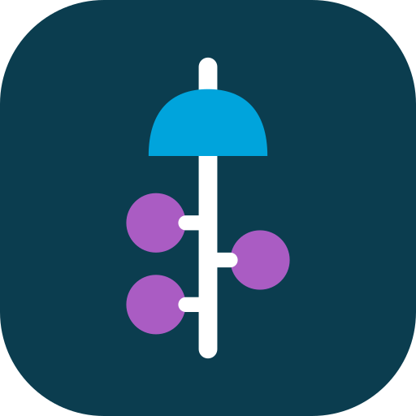
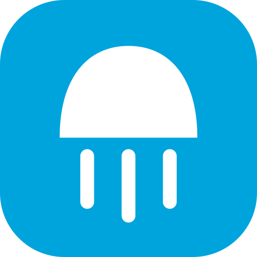

# Brand

Logos and artwork for Siphonophore and its projects. Every file is an SVG and every file here is a placeholder until the final artwork is made.

| | Project | Color | Folder |
| --- | --- | --- | --- |
|  | Siphonophore | `#0B3D4F` | [siphonophore](siphonophore) |
|  | Necto | `#00A4DC` | [necto](necto) |
|  | Zooid | `#AA5CC3` | [zooid](zooid) |
|  | Stolon | `#6E7781` | [stolon](stolon) |

## Files

Each project folder holds the same files.

| File | Use |
| --- | --- |
| `logo.svg` | The square mark, for README headers and avatars. |
| `catalog.svg` | The 16:9 image the Jellyfin plugin catalog shows. |
| `card.svg` | The project card on the organization profile. It follows the reader's light or dark theme. |

The siphonophore folder has no card. It has `banner.svg` instead.

## Banner


Every project README ends with this banner. It follows the reader's light or dark theme.

```html
<a href="https://github.com/siphonophore-org"></a>
```

## Linking

Outside this repository, link to a file by its raw URL so it always shows the current artwork:

```
https://raw.githubusercontent.com/siphonophore-org/siphonophore/main/brand/necto/logo.svg
```
